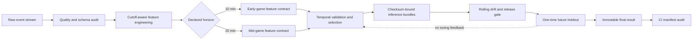

# League of Legends Challenger Rank Analytics

> **A time-aware, leakage-resistant ML case study that turns an exploratory notebook into an auditable prediction system.**


This project predicts whether **Team 100 will win** using only information available at a declared point in a League of Legends match. It deliberately treats the 10-minute and 20-minute questions as different products: an earlier signal is more actionable, while a later signal is more discriminative.

The work goes beyond fitting a classifier. It demonstrates how I design ML evidence that can survive scrutiny: temporal validation, feature-availability contracts, cohort governance, uncertainty estimates, one-time holdout release, immutable result manifests, and CI checks that cannot silently rescore the final holdout.

**Stack:** Python · pandas · scikit-learn · PyArrow · joblib · uv · pytest · Jupyter · GitHub Actions

**Project status:** Complete case study · final holdout consumed once · results frozen · post-release tuning locked

## Results at a glance

These are the final one-time results on the strictly later Europe holdout from May 2025:

| Decision point | Eligible matches | ROC-AUC | 95% bootstrap CI | Accuracy | Brier score | Interpretation |
|---|---:|---:|---:|---:|---:|---|
| **Early game — 10 minutes** | 498 | **0.7844** | [0.7424, 0.8227] | 0.7209 | 0.1897 | Useful earlier signal with more uncertainty |
| **Mid game — 20 minutes** | 404 | **0.8667** | [0.8305, 0.8997] | 0.7995 | Stronger signal, but later and conditional on reaching 20m |

On the same 404 matches that reached 20 minutes, ROC-AUC increased from **0.7218 at 10 minutes** to **0.8667 at 20 minutes**. The paired difference was **+0.1449**, with a 95% bootstrap interval of **[+0.0985, +0.1903]**.

> [!IMPORTANT]
> The 0.8667 score is a **mid-game result**, not an early-game claim. Earlier values near 0.90 in the project are also reported only for 20-minute models.

### What the result means

- Waiting until minute 20 materially improves ranking performance, but reduces decision lead time and excludes matches that ended earlier.
- The 10-minute model remains the honest early-game estimate; it never receives 20-minute features.
- Platt calibration was evaluated using development-only temporal out-of-fold predictions and rejected because it worsened both Brier score and log loss. Base probabilities were retained instead of selecting a better-looking method after the fact.
- The final holdout changed time, patch, and region together. It is evidence for this specific transfer setting, not proof of universal generalization.

## Why this project stands out

| ML engineering challenge | What I implemented | Evidence in the repository |
|---|---|---|
| Prevent future information from entering an early model | Timestamp cutoffs plus a registry of feature availability | Leakage tests and versioned runtime contracts |
| Evaluate a changing game environment | Absolute-time splits, expanding-window CV, rolling drift checks | Temporal folds, bootstrap intervals, PSI/KS reports |
| Keep evaluation cohorts from becoming training data | Checksum-bound cohort roles and pre-read authorization | Frozen policy and operation guards |
| Avoid tuning on the final answer | Explicit one-time holdout release and post-release lockout | Release ledgers and `final_holdout_consumed` manifest |
| Make the analysis reviewable by another engineer | Modular CLI, dependency lock, deterministic fixture, CI notebook | [`src/lol_analytics/`](src/lol_analytics/), [`uv.lock`](uv.lock), [105 tests](tests/), [GitHub Actions](.github/workflows/ci.yml) |
| Report an inconvenient result honestly | Rejected harmful calibration and retained base probabilities | Frozen calibration decision and null calibrator artifacts |

## System design



The dashed path is intentionally blocked: after the future holdout is consumed, model selection, base-model fitting, calibrator fitting, feature selection, and threshold tuning are rejected.

### Key review artifacts

| Artifact | What it proves |
|---|---|
| [`final-results-v1.json`](data/manifests/final-results-v1.json) | Final metrics, intervals, artifact hashes, and `final_holdout_consumed` state |
| [`cohort-policy-v1.json`](data/manifests/cohort-policy-v1.json) | Immutable roles and allowed operations for every cohort |
| [`model-input-v1.json`](data/contracts/model-input-v1.json) | Separate runtime feature contracts for 10-minute and 20-minute models |
| [`case_study.ipynb`](notebooks/case_study.ipynb) | Thin executable narrative used by the notebook smoke test |
| [`ci.yml`](.github/workflows/ci.yml) | Lock verification, tests, final-evidence audit, sample reproduction, and notebook execution |

## Recruiter quick navigation

- [Run the project locally](#quickstart--reproduce-locally)
- [Review the final holdout result](#one-time-future-holdout-release)
- [Inspect methodology and validation](#methodology)
- [See final audit and CI guardrails](#final-audit-and-ci-guardrails)
- [Review tests](#tests-and-notebook-smoke-test)
- [Understand limitations](#limitations)
- [Browse the repository layout](#repository-layout)

## Engineering highlights

- Extracted acquisition, validation, feature engineering, chronological splitting, training, leakage audit, metrics, and reporting from the notebook into reusable modules under [`src/lol_analytics/`](src/lol_analytics/).
- Added an explicit `available_at_ms` contract for every feature. A 10-minute run rejects 20-minute, outcome, identifier, duration, and unregistered columns.
- Computed first objectives **as of the cutoff**: `1` for Team 100, `-1` for Team 200, and `0` when the objective has not happened yet.
- Kept learned imputation and scaling inside training-only scikit-learn pipelines.
- Pinned dependencies with [`uv.lock`](uv.lock); raw data, models, predictions, reports, caches, and credentials remain outside version control.
- Added a deterministic 12-match fixture so the complete pipeline can run without downloading a large dataset. Fixture scores validate plumbing only.
- Preserved the original [`LoL Analytics.ipynb`](LoL%20Analytics.ipynb) as historical context while moving executable project logic into tested Python modules.

## Quickstart — reproduce locally

Install [uv](https://docs.astral.sh/uv/), then run from the repository root:

```bash
uv run --locked lol-analytics reproduce --input data/sample/events.jsonl --output artifacts/sample
```

This produces:

```text
artifacts/sample/
├── match_features.parquet
├── model_10m.joblib
├── model_20m.joblib
├── report.md
├── run.json
├── test_predictions_10m.csv
└── test_predictions_20m.csv
```

The default run trains two distinct logistic-regression pipelines: an early-game model restricted to the 10-minute contract and a mid-game model allowed to use 20-minute state. Each has its own eligible cohort, absolute-time split, feature list, leakage audit, model bundle, predictions, and metrics. Use `--horizon 10` or `--horizon 20` only when an isolated run is desired. The implementation is intentionally inspectable and deterministic; it is not presented as a production model.

## Full real-data evidence trail

The remote source is [`gptilt/lol-ultimate-events-challenger-10m`](https://huggingface.co/datasets/gptilt/lol-ultimate-events-challenger-10m), config `events`, split `train_region_americas`. The commands below document the historical real-data workflow from acquisition through final audit. They require network access and larger local files.

Because the final holdout has already been consumed, the committed post-release guard now blocks real-cohort selection and fitting. Use the quickstart for a safe executable demonstration; use this trail to review how the frozen evidence was produced.

<details>
<summary><strong>Show the complete real-data command sequence</strong></summary>

<br>

```bash
uv sync --locked --extra acquisition
uv run --locked lol-analytics acquire --matches 2000 --batch-size 10000 --output data/raw/events_americas_2000.parquet --manifest data/manifests/americas-2000.json
uv run --locked lol-analytics audit-data --input data/raw/events_americas_2000.parquet --output artifacts/data-audit-2000.json --expected-matches 2000
uv run --locked lol-analytics benchmark --input data/raw/events_americas_2000.parquet --output artifacts/real-benchmark-2000 --bootstrap-iterations 2000 --cv-splits 3
uv run --locked lol-analytics acquire --matches 300 --split test_region_europe --output data/raw/events_europe_test_300.parquet --manifest data/manifests/europe-test-300.json
uv run --locked lol-analytics validate-external --training-input data/raw/events_americas_2000.parquet --external-input data/raw/events_europe_test_300.parquet --output artifacts/external-europe-2000 --bootstrap-iterations 2000
uv run --locked lol-analytics acquire --matches 105 --split test_region_americas --output data/raw/events_americas_test_105.parquet --manifest data/manifests/americas-test-105.json
uv run --locked lol-analytics acquire --matches 105 --split train_region_asia --output data/raw/events_asia_train_105.parquet --manifest data/manifests/asia-train-105.json
uv run --locked lol-analytics validate-shifts --training-input data/raw/events_americas_2000.parquet --same-region-input data/raw/events_americas_test_105.parquet --cross-region-input data/raw/events_asia_train_105.parquet --output artifacts/shift-validation-2000 --bootstrap-iterations 2000
uv run --locked lol-analytics validate-nested --input data/raw/events_americas_2000.parquet --output artifacts/nested-validation-2000 --outer-splits 3 --inner-splits 2 --c-grid 0.01 0.1 1 10 --bootstrap-iterations 2000
uv run --locked lol-analytics validate-robustness --input data/raw/events_americas_2000.parquet --output artifacts/robustness-validation-2000 --outer-splits 3 --inner-splits 2 --repeats 5 --max-shift-fraction 0.4 --c-grid 0.01 0.1 1 10 --bootstrap-iterations 2000 --refit-bootstrap-iterations 100 --refit-block-size 50
uv run --locked lol-analytics fit-final-models --training-input data/raw/events_americas_2000.parquet --selection-evidence artifacts/robustness-validation-2000/robustness_validation.json --output artifacts/final-models-2000 --manifest data/manifests/final-models-2000.json
uv run --locked lol-analytics acquire-high-diamond --output data/raw/high-diamond-10m/high_diamond_ranked_10min.csv --manifest data/manifests/high-diamond-10m.json
uv run --locked lol-analytics validate-rank-era --input data/raw/high-diamond-10m/high_diamond_ranked_10min.csv --source-manifest data/manifests/high-diamond-10m.json --final-model-manifest data/manifests/final-models-2000.json --output artifacts/rank-era-validation-2000 --bootstrap-iterations 2000
uv run --locked lol-analytics write-data-contracts --output data/contracts/model-input-v1.json
uv run --locked lol-analytics audit-monitoring --training-input data/raw/events_americas_2000.parquet --external-input data/raw/high-diamond-10m/high_diamond_ranked_10min.csv --external-source-manifest data/manifests/high-diamond-10m.json --final-model-manifest data/manifests/final-models-2000.json --robustness-summary artifacts/robustness-validation-2000/robustness_validation.json --contract data/contracts/model-input-v1.json --output artifacts/monitoring-audit-2000 --bins 10 --bootstrap-iterations 2000
uv run --locked lol-analytics acquire --matches 500 --split train_region_europe --batch-size 10000 --output data/raw/events_europe_future_500.parquet
uv run --locked lol-analytics freeze-holdout --training-input data/raw/events_americas_2000.parquet --holdout-input data/raw/events_europe_future_500.parquet --manifest data/manifests/europe-future-500.json --expected-matches 500 --allow-region-shift --source-split train_region_europe --source-batch-size 10000 --prior-cohort-input data/raw/events_europe_test_300.parquet --prior-cohort-input data/raw/events_americas_test_105.parquet --prior-cohort-input data/raw/events_asia_train_105.parquet
uv run --locked lol-analytics freeze-cohort-policy --output data/manifests/cohort-policy-v1.json --manifest-dir data/manifests
uv run --locked lol-analytics audit-cohort-policy --policy data/manifests/cohort-policy-v1.json --verify-raw-files
uv run --locked lol-analytics calibrate-temporal --development-input data/raw/events_americas_2000.parquet --cohort-policy data/manifests/cohort-policy-v1.json --robustness-summary artifacts/robustness-validation-2000/robustness_validation.json --final-model-manifest data/manifests/final-models-2000.json --output artifacts/calibration-phase-2 --manifest data/manifests/calibration-v1.json --bins 10 --bootstrap-iterations 2000
uv run --locked lol-analytics build-inference-bundles --development-input data/raw/events_americas_2000.parquet --cohort-policy data/manifests/cohort-policy-v1.json --final-model-manifest data/manifests/final-models-2000.json --calibration-manifest data/manifests/calibration-v1.json --contract data/contracts/model-input-v1.json --output artifacts/inference-bundles-v1 --manifest data/manifests/inference-bundles-v1.json
uv run --locked lol-analytics build-release-readiness --development-input data/raw/events_americas_2000.parquet --future-holdout-input data/raw/events_europe_future_500.parquet --cohort-policy data/manifests/cohort-policy-v1.json --future-holdout-manifest data/manifests/europe-future-500.json --final-model-manifest data/manifests/final-models-2000.json --calibration-manifest data/manifests/calibration-v1.json --inference-manifest data/manifests/inference-bundles-v1.json --contract data/contracts/model-input-v1.json --robustness-summary artifacts/robustness-validation-2000/robustness_validation.json --ci .github/workflows/ci.yml --output artifacts/release-readiness-v1 --manifest data/manifests/release-readiness-v1.json --windows 5 --calibration-bins 10
uv run --locked lol-analytics release-future-holdout --future-holdout-input data/raw/events_europe_future_500.parquet --cohort-policy data/manifests/cohort-policy-v1.json --readiness-manifest data/manifests/release-readiness-v1.json --future-holdout-manifest data/manifests/europe-future-500.json --inference-manifest data/manifests/inference-bundles-v1.json --output artifacts/future-holdout-release-v1 --confirm-one-time-release --bootstrap-iterations 2000 --calibration-bins 10
uv run --locked lol-analytics freeze-final-results --release-manifest data/manifests/future-holdout-release-v1.json --release-started-manifest data/manifests/future-holdout-release-started-v1.json --inference-manifest data/manifests/inference-bundles-v1.json --calibration-manifest data/manifests/calibration-v1.json --final-model-manifest data/manifests/final-models-2000.json --output data/manifests/final-results-v1.json
uv run --locked lol-analytics audit-final-results --verify-artifacts
```

</details>

`data/raw/`, processed Parquet files, and model/report outputs are excluded from version control. Acquisition keeps only matches that reach `GAME_END`, retains the dataset's `gameStartTimestamp`, and records stream completion order separately as provenance-only `match_order`.

### Audited 2,000-match acquisition

The committed manifest at `data/manifests/americas-2000.json` describes the local, ignored raw file acquired from the Americas training split. The older 300-match manifest remains only as historical provenance:

- 2,074,056 retained events across exactly 2,000 complete matches;
- one `GAME_END`, one valid winner, and unique `(matchId, eventId)` values for every match;
- 1,038 Team 100 wins and 962 Team 200 wins;
- patches 15.6: 110 matches, 15.7: 1,514, and 15.8: 376;
- platforms BR1: 397, LA1: 248, LA2: 298, and NA1: 1,057;
- UTC match-start range 2025-04-01 through 2025-04-19;
- all matches surviving to each horizon have a usable cutoff snapshot.

The ignored Parquet is 20,867,641 bytes with SHA-256 `4fbbac26cac22a3fd84e318dab6eb040b577c856720d198b0bd57bba9608d7af`. Only 1,994 matches reach 10 minutes and 1,692 reach 20 minutes. Training therefore uses separate eligible cohorts and absolute-time splits for the two horizons. A match that has already ended is never treated as a valid 10- or 20-minute observation. `winningTeam` is intentionally sparse at event-row level and is validated once per match.

The external-validation manifest at `data/manifests/europe-test-300.json` records a separate 300-match sample from the dataset's predefined `test_region_europe` split. It contains 306,147 retained events, 146 Team 100 wins and 154 Team 200 wins, with 300 matches eligible at 10 minutes and 263 at 20 minutes. All quality gates pass. The ignored raw Parquet file is 3,562,910 bytes with SHA-256 `a2db95a299ce83c6fcecca6be3f60b8a1c658e5d0d7eb38fee94dfe9370691c4`.

The controlled-shift manifests add all 105 complete matches available from `test_region_americas` and a same-sized sample from `train_region_asia`. The Asia split is used only for evaluation; no Asia row fits preprocessing or the classifier. Americas-test contains 103,305 events and Asia contains 110,462 events. Both cover April 2025 and patches 15.6–15.8, and both manifests pass every quality gate.

### Frozen future holdout (pre-release evidence)

`data/manifests/europe-future-500.json` records the separate 500-match `train_region_europe` cohort in its original pre-release state. It is not the previously evaluated `test_region_europe` cohort. That historical manifest remains unchanged because its checksum binds Phases 1–5. The freeze command performed schema, quality, checksum, identity-overlap, region-policy, and strict-time checks only; it did not build a model, write predictions, or compute performance metrics. Phase 5 later consumed the cohort once, as recorded by the separate release ledger.

- 498 matches are eligible at 10 minutes and 404 at 20 minutes;
- patches 15.9: 449 matches and 15.10: 51;
- UTC match-start range 2025-05-01 through 2025-05-15;
- earliest holdout start is 1,006,959,527 ms after the latest Americas training start;
- zero match-ID overlap with the 2,000-match training cohort or any previously evaluated Europe, Americas-test, and Asia cohort;
- ignored Parquet size 5,483,107 bytes; SHA-256 `91baf181449ef26c716ea3bcb77d430ddc4d04989861627838867180fb842e76`;
- the pre-release manifest status is `frozen_unscored` and all of its historical performance-result flags are false.

The source offers no untouched Americas cohort strictly after the April training window: a 500-match continuation probe remained inside the same April period and was rejected by the freeze gate. This holdout is therefore explicitly classified as `future_external_region`. Its eventual release measures combined future-time and Americas-to-Europe transfer; it cannot separate a time effect from a region effect. It was kept unscored until the feature contract, final model-selection policy, inference bundles, and release-readiness gates were fixed.

### Frozen cohort roles

`data/manifests/cohort-policy-v1.json` freezes the role and checksum evidence for every existing cohort before calibration. The policy is deterministic and write-once: regeneration refuses changed manifests, roles, or file evidence.

| Cohort key | Units | Frozen role | Allowed use before holdout release |
|---|---:|---|---|
| `development_americas_2000` | 2,000 matches | Development | Feature engineering, temporal validation, selection, base-model/calibrator fitting, monitoring reference |
| `diagnostic_americas_test_105` | 105 matches | Diagnostic external | Evaluation and monitoring only |
| `diagnostic_asia_105` | 105 matches | Diagnostic external | Evaluation and monitoring only |
| `diagnostic_europe_test_300` | 300 matches | Diagnostic external | Evaluation and monitoring only |
| `diagnostic_diamond_historical_9879` | 9,879 rows | Diagnostic external, 10m only | Evaluation and monitoring only |
| `future_europe_500` | 500 matches | Future holdout | Integrity check only |

The operation guard runs before data loading in external, shift, nested/robustness, final-fit, rank/era, and monitoring workflows. A forbidden role is rejected without opening the file; an allowed operation must then match the registered file size and SHA-256 before parsing begins. Diagnostic cohorts are rejected for model selection, base-model fitting, or calibrator fitting. The immutable pre-release policy rejects the future cohort for every operation except `integrity_check`; Phase 5 preserves that hash-bound evidence and records its one-time `final_evaluation` override in a separate release ledger.

The completed integrity audit verified all six manifest hashes, raw-file sizes, and raw-file SHA-256 values. For the future holdout, this means reading bytes only to recompute its checksum: no Parquet rows were parsed, no labels were read, no predictions were written, and no metric was computed. The manifest-bound separation evidence remains zero overlap with development and the three Riot diagnostic cohorts; the Diamond adapter uses a separate prefixed identity namespace.

## Methodology

The feature registry supports 10- and 20-minute horizons. Features include team differences for gold, XP, CS, jungle CS, level, kills, towers, dragons, Heralds, and Barons plus cutoff-aware first-objective side indicators. End-of-match totals and duration are retained only as descriptive metadata.

The split is a deterministic absolute-time holdout: earlier `gameStartTimestamp` values train the model and the newest values form the test set. The field is validated as Unix epoch milliseconds, must be present and constant within each match, and is converted to UTC for reporting. `run.json` records the strategy, source column, timezone, boundary, and train/test time ranges. `match_order` is never accepted as implicit chronology.

### Verified temporal benchmark

The locked pipeline was run on the audited 2,000-match acquisition with a newest-25% absolute-time holdout, 2,000 stratified bootstrap resamples, and three expanding temporal folds:

| Model | Eligible | Holdout ROC-AUC | 95% bootstrap CI | Fold mean ± SD | Pooled temporal OOF AUC |
|---|---:|---:|---:|---:|---:|
| Early game, 10 minutes | 1,994 | **0.7567** | 0.7134–0.7980 | 0.7567 ± 0.0033 | 0.7561 (0.7318–0.7790) |
| Mid game, 20 minutes | 1,692 | **0.8744** | 0.8407–0.9067 | 0.8846 ± 0.0131 | 0.8820 (0.8646–0.8991) |

For a paired comparison on the same 20-minute-eligible cohort and same 423-match holdout, the 10-minute model scored 0.6914 and the 20-minute model scored 0.8744. The paired ΔAUC was +0.1830 with a 95% bootstrap interval of +0.1414 to +0.2288. This paired early score is conditional on games surviving to minute 20 and is not the primary early-game estimate.

Across the three expanding windows, the paired out-of-fold comparison contains 1,269 non-overlapping test predictions. On that common cohort, pooled ROC-AUC was 0.6929 (95% bootstrap interval 0.6639–0.7214) at 10 minutes and 0.8820 (0.8646–0.8991) at 20 minutes. The paired ΔAUC was +0.1890 (0.1631–0.2177). Each match appears in at most one test fold; the first chronological block is used only for initial training and therefore has no out-of-fold prediction.

The higher score is explicitly a **mid-game** result. It must not be presented as 10-minute prediction performance or as a reproduction of the legacy notebook's early-game claim. Generated models, predictions, and benchmark reports remain ignored artifacts; `lol-analytics benchmark` regenerates them from the audited raw file.

### External-region validation

The locked pipeline was also fitted on all eligible matches from the 2,000-match Americas training sample and evaluated once, without refitting, on the disjoint Europe test-split sample. The workflow rejects overlapping match IDs or region labels. Training covers patches 15.6–15.8 from April 1–19, 2025; the external sample covers patches 15.9–15.10 from May 1–16, 2025.

| Model | Training eligible | Europe eligible | External ROC-AUC | 95% bootstrap CI |
|---|---:|---:|---:|---:|
| Early game, 10 minutes | 1,994 | 300 | **0.7863** | 0.7334–0.8359 |
| Mid game, 20 minutes | 1,692 | 263 | **0.9026** | 0.8678–0.9374 |

On the same 263 Europe matches that survive to 20 minutes, early-game ROC-AUC was 0.7485 and mid-game ROC-AUC was 0.9026. The paired ΔAUC was +0.1541 with a 95% bootstrap interval of +0.0978 to +0.2119. The 0.9026 result is a mid-game external-validation estimate, not a 10-minute claim.

Because region, calendar window, and patch all change together, this is a combined distribution-shift test. It provides evidence for this one Americas-to-Europe transfer sample but does not isolate a causal regional effect or establish generalization to other ranks, regions, patches, or seasons.

### Controlled same-period region shift

To reduce the time/patch confounding, one model per horizon was fitted on Americas training data and evaluated without refitting on two independent cohorts: 105 Americas-test matches and 105 Asia matches. The workflow hard-fails if match IDs overlap, region roles are wrong, shared patch support is empty, or the three time ranges do not overlap.

| Model | Americas test N | Americas AUC | Asia N | Asia AUC | ΔAUC Asia − Americas | 95% independent bootstrap CI |
|---|---:|---:|---:|---:|---:|---:|
| Early game, 10 minutes | 103 | 0.7680 | 105 | 0.8374 | +0.0694 | −0.0541–+0.1852 |
| Mid game, 20 minutes | 86 | 0.8854 | 80 | 0.8575 | −0.0279 | −0.1448–+0.0867 |

Both intervals include zero, so this sample does not resolve a regional AUC difference at either horizon. The comparison is unpaired because Americas and Asia contain different matches; every bootstrap iteration resamples the cohorts independently. The 20-minute row remains a mid-game result.

### Nested temporal model selection

The regularization parameter is selected independently inside each outer training window using two inner expanding folds. The selected pipeline is then refitted on the complete outer training window and evaluated once on its untouched future block. No outer test row participates in imputation, scaling, fitting, or hyperparameter selection.

| Model | Eligible | Outer OOF N | Nested pooled ROC-AUC | 95% bootstrap CI | Selected `C` across folds |
|---|---:|---:|---:|---:|---|
| Early game, 10 minutes | 1,994 | 1,495 | **0.7570** | 0.7322–0.7805 | 0.01: 2 folds; 1: 1 fold |
| Mid game, 20 minutes | 1,692 | 1,269 | **0.8820** | 0.8646–0.8991 | 0.1: 3 folds |

On the paired 20-minute-eligible cohort, nested outer-fold ROC-AUC was 0.7008 at 10 minutes and 0.8820 at 20 minutes. The paired ΔAUC was +0.1812 with a 95% bootstrap interval of +0.1554 to +0.2098. The higher value remains a mid-game result.

The early-game selections still vary across folds, although the extreme `C=10` selected in the 300-match run disappears. Nested validation estimates the performance of the selection procedure; it does not by itself choose or validate a final deployment model.

### Repeated temporal robustness and refit uncertainty

The robustness workflow repeats nested validation over five symmetrically shifted temporal boundaries. Each repeat preserves expanding-window chronology and performs hyperparameter selection only inside the outer training period. Repeats share observations and are therefore correlated sensitivity analyses, not independent experiments; their standard deviation is not a confidence interval.

| Model | Eligible | Repeated nested AUC mean ± SD | Range across five cut-point repeats | Selected `C` across 15 outer folds |
|---|---:|---:|---:|---|
| Early game, 10 minutes | 1,994 | **0.7583 ± 0.0027** | 0.7562–0.7617 | 0.01: 10; 0.1: 1; 1: 3; 10: 1 |
| Mid game, 20 minutes | 1,692 | **0.8811 ± 0.0015** | 0.8793–0.8828 | 0.1: 14; 10: 1 |

For the unshifted base repeat, each outer training window was additionally resampled in contiguous 50-match temporal blocks. Preprocessing and logistic regression were refitted 100 times per outer fold, for 1,200 bootstrap refits across the two natural-cohort and two paired-cohort model runs. The natural-cohort fold intervals were:

| Model | Outer fold 1 | Outer fold 2 | Outer fold 3 |
|---|---:|---:|---:|
| Early game, 10 minutes | 0.7548 [0.7461, 0.7569] | 0.7568 [0.7417, 0.7628] | 0.7625 [0.7541, 0.7683] |
| Mid game, 20 minutes | 0.8994 [0.8821, 0.8997] | 0.8801 [0.8734, 0.8819] | 0.8744 [0.8636, 0.8808] |

On the shared 20-minute-eligible cohort, the repeated paired ΔAUC (mid minus early) averaged +0.1815 with SD 0.0039 and ranged from +0.1771 to +0.1873. The base-repeat prediction-bootstrap interval was +0.1812 [0.1554, 0.2098]; that paired interval still conditions on its fitted models, while the per-fold intervals above include training refits. No frozen future-holdout row was read. The higher values remain mid-game results and are not early-game claims.

### Frozen final model-selection policy

Final hyperparameters are chosen by one deterministic policy fixed before future-holdout release: select the modal `C` across the 15 repeated nested outer-fold decisions, with the smaller `C` as the tie-breaker. The fitter verifies the training/evidence paths, feature contracts, eligible counts, leakage audits, decision counts, and checksums before fitting on all eligible development matches.

| Final model | Eligible development matches | Selection evidence | Selected `C` |
|---|---:|---|---:|
| Early game, 10 minutes | 1,994 | 0.01 selected in 10/15 outer folds | **0.01** |
| Mid game, 20 minutes | 1,692 | 0.1 selected in 14/15 outer folds | **0.1** |

The checksum-bound manifest at `data/manifests/final-models-2000.json` has status `final_models_fitted_unreleased`. The ignored artifacts are `final_model_10m.joblib` (1,741 bytes; SHA-256 `2c7b45ece544f9a96966204781eaae700a9bec9b10cb06c89ee239786167623c`) and `final_model_20m.joblib` (2,257 bytes; SHA-256 `a55de97ab86716fdd68c9544d3138d30173e66fabcf720487f119bee6c92e088`). No in-sample metric was computed, and the frozen future holdout was neither accessed nor scored. These fitted artifacts are not additional performance evidence.

### External rank and historical-era stress test

The frozen early-game model was scored without refitting on the public [League of Legends Diamond Ranked Games (10 min)](https://www.kaggle.com/datasets/bobbyscience/league-of-legends-diamond-ranked-games-10-min) dataset. Its official metadata describes 9,879 unique Diamond I–Master solo-queue games, 10-minute snapshots, a CC0 license, and a last update on April 13, 2020. The downloaded CSV is ignored; the committed source manifest pins its 1,446,502 bytes and SHA-256 `82b2e23279097c2dac616e966eb2911711c428d41b6382b4cdb15da4892f9ca6`.

The adapter validates redundant blue/red totals before mapping Team Blue to Team 100. Ten features are direct or exact derivations, `baron_diff_10` is the structural zero at this horizon, and the unavailable first-dragon, first-tower, and first-Herald side indicators remain missing for the already-fitted training imputer. Objective counts are not used as proxies for which team took an objective first.

| Model actually scored | External rows | ROC-AUC | Stratified bootstrap 95% interval |
|---|---:|---:|---:|
| Early game, 10 minutes | 9,879 | **0.8041** | [0.7958, 0.8123] |

This is a combined rank, historical-era, and schema-availability stress test. The source does not expose match timestamps, patch, or season, so the result is not a clean estimate of a named season effect. The 20-minute final model was neither loaded nor scored because a 10-minute-only source cannot support the mid-game feature contract. The frozen May 2025 future holdout remained untouched. In particular, this result does not turn a mid-game ROC-AUC near 0.90 into an early-game claim.

### Calibration, drift, and runtime contracts

The committed `data/contracts/model-input-v1.json` is generated directly from the feature registry. Runtime validation hard-fails missing required columns, registered features from a later horizon, non-numeric or infinite values, duplicate match IDs, invalid side indicators, and an entirely missing feature unless that source-specific exception is declared. Both development contracts pass. The Diamond source passes the early-game contract only with its three unavailable first-objective-side features explicitly declared; those exceptions are recorded in the audit rather than silently accepted.

Calibration is diagnostic: no post-hoc calibrator is fitted or deployed from external labels. Development values use only the base-repeat repeated-nested out-of-fold predictions; the external value uses the frozen final early-game model.

| Calibration cohort | Model/evidence | N | Brier | Log loss | 10-bin ECE | Bootstrap 95% ECE interval |
|---|---|---:|---:|---:|---:|---:|
| Development early | Nested temporal OOF, 10m | 1,496 | 0.2001 | 0.5831 | 0.0245 | [0.0182, 0.0502] |
| Development mid | Nested temporal OOF, 20m | 1,269 | 0.1403 | 0.4287 | 0.0318 | [0.0252, 0.0576] |
| Diamond I–Master external | Frozen final early model, 10m | 9,879 | 0.1809 | 0.5375 | 0.0164 | [0.0136, 0.0234] |

These rows are not a paired early-versus-mid calibration comparison: the external source has no 20-minute state, while the development rows come from selection-procedure OOF predictions rather than the final fitted artifacts.

Feature drift from the 1,994-match early development reference to the Diamond source is classified by declared heuristic PSI, KS, missingness, and reference-range thresholds: 7 low, 1 medium, and 6 high alerts. The three unavailable first-objective features are high by construction; Herald, level, and XP also trigger high alerts, while gold triggers medium. The prediction distribution triggers a medium alert. These alerts describe a combined rank/era/schema shift and are not causal tests. Training labels are not used when constructing the prediction-distribution reference.

### Temporal cross-fitted calibration decision

Phase 2 evaluated one fixed method—Platt scaling on clipped probability logits—using only the base-repeat development OOF predictions. For each horizon, fold 1 trained the first mapping, fold 2 was evaluated from fold-1 evidence, and fold 3 was evaluated from folds 1–2. The first fold is therefore excluded from the paired calibration estimate. A final mapping was fitted on all development OOF predictions only to obtain its parameters, but it is packaged only if both temporally cross-fitted Brier score and log loss are non-worsening.

| Horizon | Base OOF N | Cross-fitted evaluation N | Raw Brier | Platt Brier | Raw log loss | Platt log loss | Decision |
|---|---:|---:|---:|---:|---:|---:|---|
| Early game, 10 minutes | 1,496 | 997 | 0.1996 | 0.2013 | 0.5818 | 0.5872 | Reject; keep base probability |
| Mid game, 20 minutes | 1,269 | 846 | 0.1457 | 0.1479 | 0.4446 | 0.4524 | Reject; keep base probability |

For early game, calibrated-minus-raw Brier was +0.00178 with paired bootstrap interval [−0.00000, +0.00359], while log-loss delta was +0.00533 [−0.00039, +0.01127]. For mid game, Brier delta was +0.00221 [+0.00104, +0.00334] and log-loss delta was +0.00786 [+0.00287, +0.01341]. Negative values would favor calibration. The fixed acceptance rule fails at both horizons, so `data/manifests/calibration-v1.json` has status `calibration_rejected_keep_base_probabilities`, both artifact fields are null, and no calibrator `.joblib` exists.

No external diagnostic label or future-holdout row was used. Base probabilities remain canonical for the next phase. Trying additional calibration methods after observing this result would introduce another model-selection step and requires a new pre-registered policy rather than an ad-hoc search.

### Checksum-bound inference bundles

Phase 3 packages each fitted final model with its exact feature list, horizon, runtime contract, source hashes, and Phase 2 probability decision. It does not refit the model or calibrator. Because both Platt mappings were rejected, the serialized transform is `identity_keep_base_probability`: `served_probability` equals `raw_probability` exactly and `calibration_applied` is false.

| Bundle | Horizon | Features | Bytes | SHA-256 | Probability transform |
|---|---:|---:|---:|---|---|
| Early game | 10 minutes | 14 | 2,462 | `0efe58d20f63471e79e4eb9c7033addb75d12eb17452da52fe9a08dc23fb1147` | Identity; keep base |
| Mid game | 20 minutes | 28 | 3,125 | `a0218a3b98e04002006b062d463b7e7ea8dec6ecb4b6cde5489e316f1475b555` | Identity; keep base |

`data/manifests/inference-bundles-v1.json` has status `inference_bundles_base_probability_unreleased`. The prediction API returns `raw_probability`, `served_probability`, `calibration_applied`, `horizon_minutes`, and `probability_transform`. It hard-fails checksum changes, contract/horizon mismatches, missing or extra features, invalid side indicators, non-numeric or infinite values, and unauthorized cohort roles before inference.

A smoke prediction on all 12 fixture matches at both horizons produced maximum absolute `raw_probability − served_probability` of exactly 0.0. External diagnostic cohorts and the frozen future holdout were not read or scored during packaging.

### Rolling development backtest and release gate

Phase 4 replays five chronological windows from the frozen development cohort. Window 1 is the monitoring reference and windows 2–5 are compared against it. Feature drift uses the horizon-specific input contract; output drift uses only the served probability. Labels are never passed to the final inference bundles, and no final-model performance metric is computed on these windows. Calibration metrics come instead from the base-repeat temporal out-of-fold predictions produced during robustness validation.

| Model | Eligible development matches | Feature drift across four comparisons (low/medium/high) | Output drift (low/medium/high) | OOF calibration folds |
|---|---:|---:|---:|---:|
| Early game, 10 minutes | 1,994 | 56 / 0 / 0 | 4 / 0 / 0 | 3 |
| Mid game, 20 minutes | 1,692 | 110 / 2 / 0 | 3 / 1 / 0 | 3 |

The drift levels are diagnostics, not performance claims or automatic release blockers. The mid-game output distribution has one medium alert; this does not change the strict separation between the 10-minute early model and the 20-minute model, and it does not make the higher mid-game AUC an early-game result.

The committed `data/manifests/release-readiness-v1.json` records **22/22 passed protocol gates** and status `ready_for_one_time_holdout_release`. The gate binds the cohort policy, future-holdout manifest, final models, rejected calibration decision, inference bundles, runtime contract, robustness evidence, and CI workflow by SHA-256. CI is checked for holdout-release references and remains limited to ordinary tests and notebook smoke execution.

Readiness is not a holdout result. Phase 4 recomputed only the future file size and SHA-256 as raw bytes; it did not parse Parquet rows, read labels, write predictions, or compute metrics. At that point `final_evaluation` was still forbidden by the immutable pre-release policy and required a separate explicit Phase 5 authorization.

### One-time future-holdout release

Phase 5 consumed the readiness gate through `--confirm-one-time-release`. It wrote a canonical `future_holdout_release_started` ledger before parsing the holdout and wrote the final ledger last. A completed call only returns the existing ledger after verifying its non-holdout evidence hashes; an incomplete start marker blocks a second read. The immutable pre-release cohort policy is retained because its SHA-256 binds all prior evidence, while the separate Phase 5 ledger records the explicit override and `release_count: 1`.

The checksum-bound Phase 3 bundles were loaded without model or calibrator refitting. Both use the identity probability transform selected in Phase 2.

| Model | Horizon | Holdout N | ROC-AUC | 95% stratified bootstrap interval | Accuracy | Brier | Log loss | 10-bin ECE |
|---|---:|---:|---:|---:|---:|---:|---:|---:|
| Early game | 10 minutes | 498 | **0.7844** | [0.7424, 0.8227] | 0.7209 | 0.1897 | 0.5574 | 0.0538 |
| Mid game | 20 minutes | 404 | **0.8667** | [0.8305, 0.8997] | 0.7995 | 0.1500 | 0.4652 | 0.0561 |

On the identical 404 matches eligible at 20 minutes, the 10-minute prediction scored 0.7218 and the 20-minute prediction scored 0.8667. The paired mid-minus-early AUC difference was +0.1449 with a 95% bootstrap interval of [+0.0985, +0.1903]. The 0.8667 result is explicitly a mid-game estimate; neither it nor any earlier mid-game value near 0.90 is an early-game claim.

The committed `data/manifests/future-holdout-release-v1.json` is the final result ledger, while `data/manifests/future-holdout-release-started-v1.json` records that the one-time access began. Row-level predictions and the generated Markdown report remain ignored artifacts. No model, calibrator, feature, classification threshold, or selection policy may be tuned from these results.

### Frozen final result

Phase 6 copies no data and computes no prediction or metric. It verifies the SHA-256 and byte size of both base models, both inference bundles, all three prediction artifacts, and the generated Phase 5 report, then writes the committed `data/manifests/final-results-v1.json` with status `final_holdout_consumed`.

The final manifest binds the original holdout checksum, eligible counts, metrics, bootstrap intervals, reliability bins, Phase 5 authorization, model/bundle checksums, and rejected-calibration decision. Both calibrator artifact fields are explicitly null because Phase 2 rejected Platt scaling. The recorded evaluation completion time is `2026-11-21T12:17:16.178842+00:00`, derived from the Phase 5 release-ledger file modification time at freeze; it is labeled with that provenance rather than presented as an application-generated event timestamp.

The manifest also records that the raw holdout was not read in Phase 6, predictions were not recomputed, `release_count` is 1, and the consumed holdout is unavailable for any future model, feature, calibration, or threshold selection. Re-running the freeze command returns the same manifest only when all source-manifest hashes remain identical.

### Final audit and CI guardrails

Phase 7 adds a manifest-only `audit-final-results` command that checks five source-manifest hashes, both horizon contracts, Phase 5 versus Phase 6 metrics and intervals, model/bundle/calibration records, the paired comparison, and every immutability flag. Its default mode works in CI without raw data, model files, predictions, or report artifacts; it records `raw_holdout_accessed: false` and `predictions_recomputed: false`. Local `--verify-artifacts` mode additionally verified all eight ignored model, bundle, prediction, and report artifacts by byte size and SHA-256.

Real-cohort `model_selection`, `fit_base_model`, `fit_calibrator`, feature selection, and threshold tuning are now rejected once `final-results-v1.json` reports `final_holdout_consumed`. Role authorization runs first, and the consumed-state guard runs before raw-file checksum access. This keeps diagnostic-role misuse errors precise while preventing the development cohort from silently becoming a post-holdout tuning set. The synthetic fixture reproduction remains permitted because it is plumbing evidence, not real-cohort model selection.

CI now performs dependency-lock verification, the complete test suite, the manifest-only final audit, end-to-end sample reproduction, and the notebook smoke test. It contains no future-holdout path or release command and therefore cannot rescore the real holdout.

## Tests and notebook smoke test

Latest local verification:

| Check | Result |
|---|---|
| Dependency lock | `uv lock --check` passed |
| Automated tests | **105 passed** |
| Final evidence audit | Passed; 5 manifest hashes and 2 horizon records verified without raw holdout access |
| Local artifact audit | Passed; 8 ignored artifacts matched byte size and SHA-256 |
| Sample reproduction | Completed for both 10-minute and 20-minute pipelines |
| Notebook smoke execution | Completed with exit code 0 |

```bash
uv sync --locked --extra dev
uv lock --check
uv run --locked pytest
uv run --locked lol-analytics audit-final-results
uv run --locked lol-analytics reproduce --input data/sample/events.jsonl --output artifacts/ci-sample
uv run --locked jupyter nbconvert --to notebook --execute notebooks/case_study.ipynb --output-dir notebooks/executed --ExecutePreprocessor.timeout=180
```

<details>
<summary><strong>Show detailed test coverage</strong></summary>

<br>

The suite covers:

- inclusive time cutoffs and rejection of future events;
- horizon/outcome leakage prevention and train-only preprocessing fit;
- absolute-time validation and chronological, non-overlapping split logic;
- expanding-window temporal validation and bootstrap ROC-AUC intervals;
- shifted repeated nested temporal boundaries and block-bootstrap model refitting;
- deterministic modal model selection, checksum-bound fitting, and holdout-contamination rejection;
- pinned external-rank acquisition, redundant-schema checks, feature mapping, checksum-bound frozen-model loading, and no-refit scoring;
- calibration scoring and bootstrap intervals, deterministic drift alerts, and versioned runtime input contracts for both horizons;
- temporal cross-fitted Platt evaluation, paired uncertainty, a frozen non-worsening rule, and rejection of harmful calibration artifacts;
- checksum-bound inference packaging, explicit raw-versus-served probability semantics, horizon-specific runtime validation, and no-refit identity fallback;
- chronological rolling-window coverage, timestamp-tie isolation, development-only drift replay, OOF calibration provenance, CI release exclusion, and an unread/unscored future-holdout readiness manifest;
- explicit one-time release confirmation, started-ledger crash lockout, idempotent read-only completion, horizon-preserving holdout evaluation, and paired early-versus-mid comparison on identical rows;
- final-result artifact checksum verification, write-once source-evidence binding, consumed-holdout state, and post-release tuning prohibition;
- manifest-only final-state audit, altered-metric rejection, pre-read consumed-state guards, CI lock verification, and CI sample reproduction without real holdout access;
- checksum-bound cohort roles, pre-read operation authorization, immutable diagnostic-only assignments, and future-holdout release blocking;
- paired horizon comparison on identical test rows;
- disjoint-match and disjoint-region external-validation guards;
- single-fit same-region versus cross-region validation with patch/time support gates;
- nested expanding-window hyperparameter selection isolated from outer test folds;
- known metric values and invalid metric inputs;
- registered feature availability;
- end-to-end reproduction on the sample fixture.

</details>

GitHub Actions verifies the lock, runs the test suite, audits final evidence without ignored artifacts, reproduces the synthetic sample case study, and executes the thin case-study notebook. It does not execute the legacy notebook because that notebook downloads remote data and contains exploratory, stateful analysis.

## Repository layout

```text
src/lol_analytics/          reusable pipeline modules
tests/                      unit and integration tests
data/sample/events.jsonl    small deterministic event fixture
data/manifests/             acquisition provenance and quality manifests
scripts/                    fixture generator
notebooks/case_study.ipynb  thin, CI-executed narrative
LoL Analytics.ipynb         legacy exploratory notebook
.github/workflows/ci.yml    locked tests + notebook smoke test
pyproject.toml / uv.lock    package metadata + dependency lock
```

## Limitations

The main boundaries are properties of the available data and study design, not issues that can be removed by another code change:

- The future holdout changes **time, patch, and region simultaneously**, so their individual effects cannot be isolated.
- The Diamond dataset has no per-match timestamp, patch, or exact season; it supports only a historical-era proxy.
- Americas-test and Asia contain only 105 matches each, leaving regional comparisons imprecise.
- PSI, KS, missingness, and range thresholds are monitoring heuristics rather than universal significance cutoffs.
- The final holdout has been consumed. A future model iteration requires a newly collected, later, identity-disjoint cohort.

<details>
<summary><strong>Show extended methodological limitations</strong></summary>

<br>

- The committed fixture is synthetic and too small for scientific interpretation.
- Training covers one Challenger regional split and a narrow patch window.
- The 20-minute cohort excludes 308/2,000 short matches, so its metrics describe games that survive to 20 minutes rather than all games observed at 10 minutes.
- Prediction-bootstrap intervals condition on fitted models. Block-bootstrap refits remain conditional on the observed temporal blocks and fixed outer test cohorts.
- Expanding temporal folds reuse earlier training observations and are not independent experiments.
- The same-period Americas-versus-Asia comparison remains observational; patch proportions, platforms, teams, and other covariates are not exactly matched.
- Each repeated validation run still has only three outer and two inner folds. Early-game regularization choices retain some instability.
- The 50-match block size is a declared sensitivity choice rather than an estimated dependence length.
- Modal selection is reproducible but does not prove that the candidate grid contains the globally best configuration.
- The Diamond adapter must impute three unavailable first-objective-side features using training-fitted medians.
- Ten-bin ECE depends on the binning choice. Platt calibration failed the frozen non-worsening rule and was not packaged.
- Inference bundles are local ignored artifacts rather than a deployed service.
- Rolling drift uses the first fifth of development as a fixed reference; it is not a historical online-training simulation.
- Chronology depends on the source dataset's `gameStartTimestamp`, whose upstream accuracy cannot be independently verified here.
- Per-player kills remain unavailable where the source `killerId` field is unpopulated.
- Champion synergy, clustering, SHAP, and dashboard experiments remain historical notebook explorations, outside the minimal supervised pipeline.
- One external rank/era stress test is not evidence of broad generalization across all ranks, regions, patches, or future seasons.

</details>
